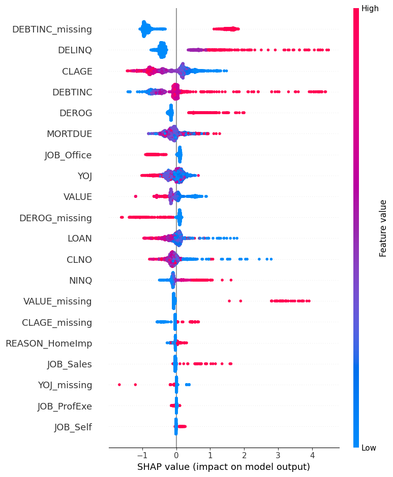

# MIT Professional Education - Applied AI & Data Science
A Capstone project based on the domain - Practical Data Science/Classification.
Scored 94/100

# Home Equity Loan Default Prediction

A binary classification model that predicts home equity loan default risk,
built with ECOA (Equal Credit Opportunity Act) compliance and interpretability
as first-class requirements rather than an afterthought.

## Problem

A bank's consumer credit department wants to replace manual underwriting of
home equity applications with a model-driven process. This has to be achieved without inheriting the biases and inconsistency of human judgment, and while keeping every rejection
traceable and defensible under ECOA.

## Approach

- **Data**: HMEQ (Home Equity) dataset — 5,960 loan records, ~20% default rate (HMEQ dataset provided with the MIT PE/Great Learning problem statement.)
- **Models compared**: Logistic Regression (baseline), Decision Tree, Random
  Forest, Explainable Boosting Machine (EBM) and XGBoost (with monotonic constraints on key features for
  ECOA-defensibility)
- **Evaluation**: precision/recall/F1/ROC-AUC prioritized over raw accuracy,
  reflecting the cost asymmetry between missed defaulters (false negatives)
  and wrongly rejected reliable borrowers (false positives)
- **Missingness**: DEBTINC and VALUE missingness is treated as signal (MNAR),
  not noise. Binary missingness indicators are retained as model features
- **Interpretability**: SHAP (TreeSHAP) for feature-level explanations
- **Bonus**: a RAG-based Adverse Action Notice Generator that drafts
  ECOA-compliant rejection reasons from SHAP output, grounded in Regulation B
  (12 CFR Part 1002 Appendix C) reason codes

## Results

Held-out test set: 1,788 applicants (30%, stratified), 357 defaulters. Recall on the default class was the primary metric, because missing a defaulter costs roughly 10x more than wrongly rejecting a good borrower.

| Model | Precision | Recall | F1 | ROC-AUC |
|---|---|---|---|---|
| Logistic Regression | 0.510 | 0.695 | 0.588 | 0.838 |
| Decision Tree (tuned) | 0.510 | 0.759 | 0.610 | 0.853 |
| Random Forest | 0.744 | 0.739 | 0.742 | 0.940 |
| **XGBoost (monotonic)** | 0.703 | **0.821** | **0.757** | 0.943 |
| EBM (monotonic) | 0.689 | **0.821** | 0.749 | **0.945** |

! [Model comparison] (docs/model_comparison.png)
**XGBoost with monotonic constraints is the recommended model.** It catches 293 of 357 defaulters and has the best F1. The constraints keep its behaviour consistent with credit logic, which makes each decision easier to defend under ECOA.



`DEBTINC_missing` is the top driver, ahead of `DELINQ` and `CLAGE`. Not reporting your debt-to-income ratio predicts default better than the ratio itself.

A RAG pipeline turns the top SHAP drivers into Regulation B adverse-action reasons. See the notebook for the cost analysis, EBM comparison, bias discussion and notice generator.

## Repo structure

- 'docs/plots.png' - Supporting visuals for the results section in the README.md
- `Loan_Default_Prediction.ipynb` — full analysis: EDA, modeling, evaluation,
  SHAP interpretability, and the adverse action notice generator
- `hmeq.csv` — dataset
- `requirements.txt` — Python dependencies

## Running it

```bash
pip install -r requirements.txt
jupyter notebook Loan_Default_Prediction.ipynb
```
Optional: set ANTHROPIC_API_KEY to have an LLM write the adverse-action notices. Without it, the notebook uses a deterministic template.

## Limitations

A full proxy-variable or disparate-impact bias audit is out of scope for this version, so it is flagged as an open limitation, not treated as solved.

## Professor Feedbacks
**Final Submission:** "You have done an excellent job on the
overall assignment. I really liked the technical accuracy, and the explanation
stood out."

**Live Presentation:** "Good structure and flow, decent
understanding of the solution, and positive notes on the fairness/ECOA angle
and the GenAI adverse-action-notice feature."

## Next steps

Export the model to ONNX and serve it from a C# app with tests, CI and prediction logging (separate repo, in progress).
